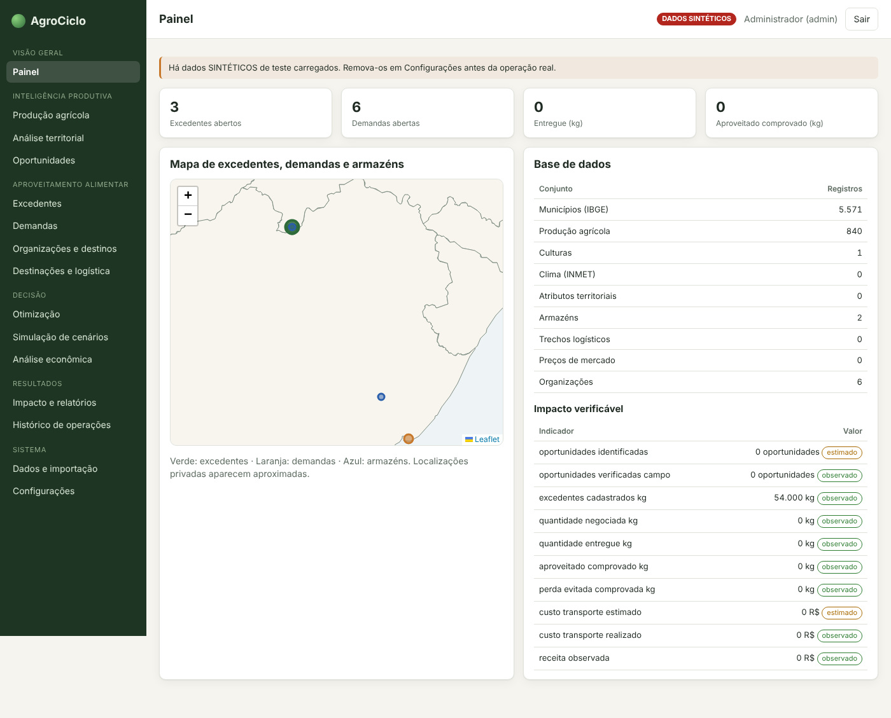
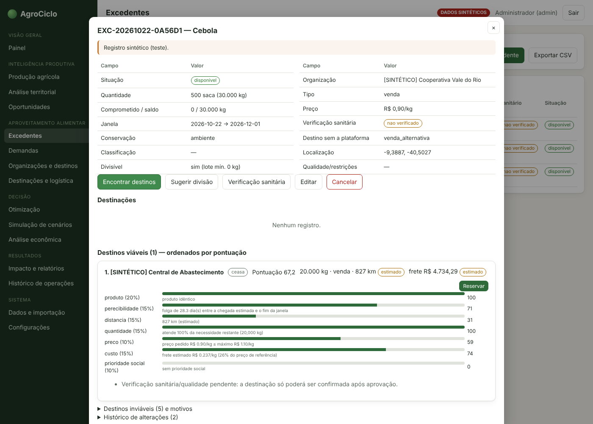
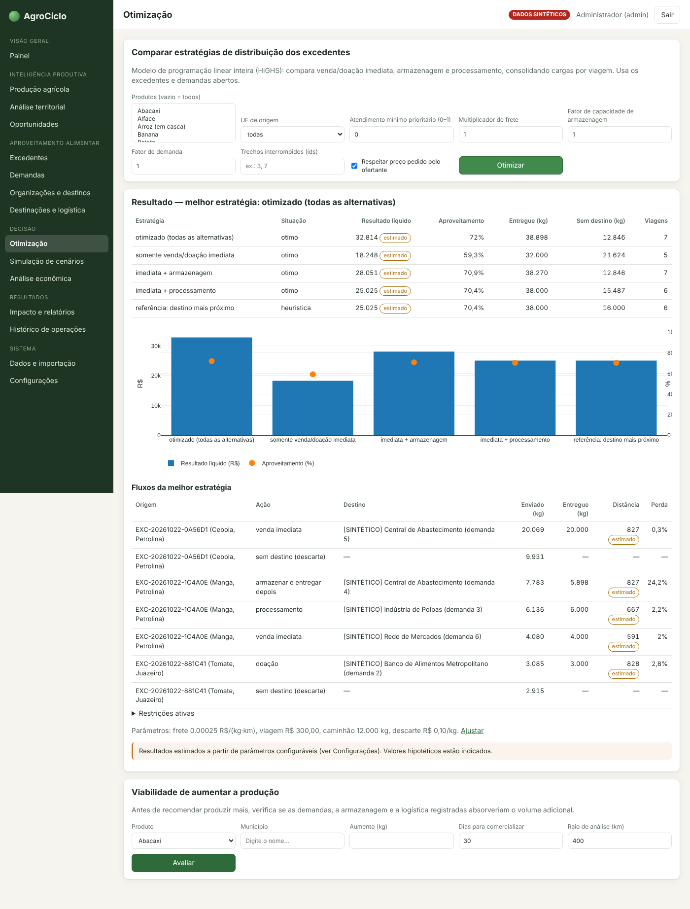
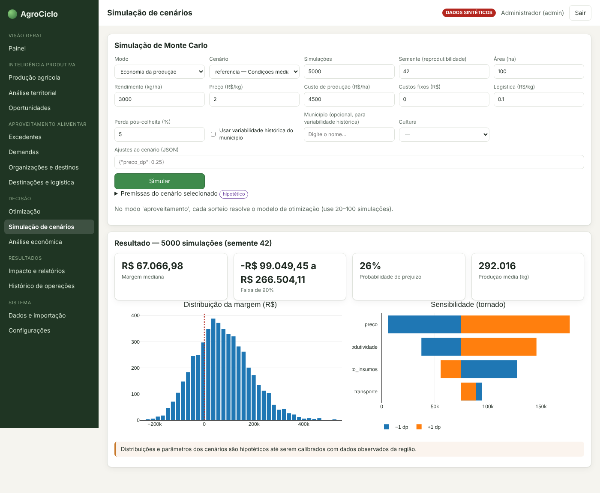

# AgroCiclo

Inteligência produtiva e aproveitamento alimentar: ajuda as regiões brasileiras a aproveitar melhor sua capacidade produtiva e a fazer mais alimento chegar a quem precisa.

## Para quem é
Gestores públicos, cooperativas, centrais de abastecimento e organizações que trabalham com produção e distribuição de alimentos.

## O que faz
- **Inteligência produtiva**: histórico da produção agrícola por município, tendências, comparação com municípios semelhantes e potencial de produção.
- **Excedentes**: cadastro de alimentos disponíveis com validade, conservação e qualidade.
- **Encontro entre oferta e demanda**: liga excedentes a compradores, cooperativas, processadores e organizações sociais, explicando cada sugestão.
- **Reservas e entregas** sem comprometer o mesmo lote duas vezes.
- **Planejamento de distribuição** e simulação de cenários com análise econômica.
- **Indicadores de impacto** só com evidência, separando o observado do estimado.

## Telas
As telas usam o cenário de demonstração do próprio sistema, com dados fictícios.

---

Este repositório é uma **vitrine** do projeto: mostra o que o sistema faz e como ele é. O código-fonte não é público.

Desenvolvido por [@won3er](https://github.com/won3er).